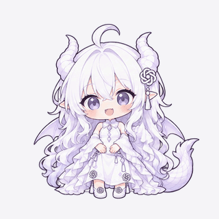
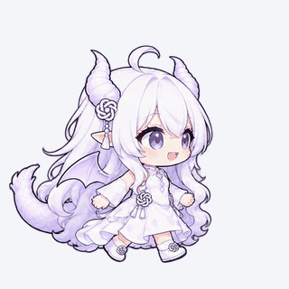
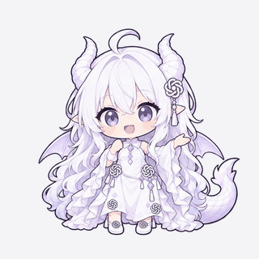
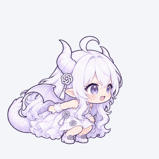
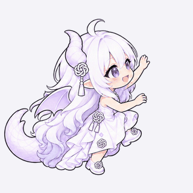

# Codex Companion · 蓝色大肥鱼 1.31.1

**简体中文** | [English](README.en.md)

让 AI 角色住在 Windows 桌面上：换皮肤、走动、和窗口互动，陪你聊天，也能在工作完成时提醒你。

Codex Companion 将桌宠动画、**Ollama 本地聊天**、**Codex 任务看板**和**本地语音**放在一起。连接功能可以按需启用；不连接 Codex 或模型，也能使用桌宠与本地动画。

当前应用界面仍显示 **AI Pet**，启动文件为 `DesktopPet.exe`。

| 功能 | 已支持 |
| --- | --- |
| 角色与动画 | 9 款角色皮肤；DeepSeek 与 GPT 状态动画，DeepSeek 新旧动画可切换 |
| 桌面互动 | 拖拽、行走、下落与落地、窗口支撑、跳跃和攀爬 |
| 对话与识图 | Ollama 地址配置、已安装模型切换、流式回答、图片拖入或粘贴 |
| 记录与记忆 | 本地会话历史、切换对话、跨对话共享记忆、可选联网搜索与网页阅读 |
| 语音 | 本地语音输入、9 角色独立选声音、音色工坊生成 / 试听 / 命名保存、音色库切换 / 重命名 / 删除、流式播放与模型加载控制 |
| 工作看板 | Codex 额度和任务、可选消息读取，Codex / Dot / 全部筛选 |
| 设置与模型 | 独立设置页，桌宠互动与声音集中管理；与聊天双向同步选模、手动加载 / 卸载、显存分色 |
| 中英文切换 | 界面、内置提示词和跟随软件语言的语音同步切换；设置页提供一键重启 |

**当前仓库提供源码与资源，需要自行构建，不包含现成的 EXE / DLL、Python 环境或模型权重。**

**设置入口：** 右键桌宠点击“设置”，或从工作看板、角色换装及托盘打开。左侧“桌宠与互动”管理显示、行走、行为、音乐与表演；“模型与语音”管理聊天/语音模型、显存、角色声音和音色工坊。换装页专注角色选择与资源导入，看板专注 Codex 工作进展。原有偏好与音色继续保留；模型状态只在对应设置页可见时刷新。

**表演入口：** 在“桌宠与互动 → 表演与情绪”选择“唱 Let Me Go”“保持 Q 弹 · 邦友的酒”或其他表情舞蹈，统一播放、停止。“音乐与唱歌”仅控制音乐开关与音量。

## 语言切换与一键重启

1. 右键桌宠，点击 **设置 → 桌宠与互动**，找到 **Language / 语言**。
2. 选择 **简体中文** 或 **English**。选择会自动保存，当前界面继续使用原语言，直到重启。
3. 点击语言选择框旁的 **重启桌宠 / Restart AI Pet**。程序会保存设置、正常退出并重新启动，自动返回设置页，应用所选语言。

仅选择语言不会中断聊天或丢弃音色工坊草稿；点击重启会停止正在进行的生成与播放。重启前请先保存需要保留的新音色。已有设置、聊天记录、Codex 配对和已保存音色会保留，Ollama 的模型设置不会改变。

界面、桌宠提示、角色人设、动作规划、联网与记忆提示词，以及新的语音工坊示例都会使用所选语言。默认回答语言随设置变化，也可以在聊天中明确要求其他语言。已有聊天记录、自定义音色名字、参考音频和自己填写的提示词不会被翻译。

DeepSeek 与 GPT 的默认音色保持原音色，朗读语言默认跟随软件。在 **模型与语音 → 语音生成方式 → 朗读语言** 可改为手动指定语言；自定义音色原有的语言设置继续保留。麦克风仍自动识别实际说出的语言；歌曲录音不会翻译或重新生成。

## 角色预览

以下是可切换的**角色皮肤**，名称不代表程序内置了对应的 9 种大语言模型。聊天使用你自行配置的 Ollama 模型；目前 **DeepSeek 与 GPT** 配有基础状态动画，独立歌曲和舞蹈仍仅提供 DeepSeek 版本。

<table>
  <tr>
    <td align="center"><br><strong>DeepSeek</strong></td>
    <td align="center"><br><strong>Gemini</strong></td>
    <td align="center"><br><strong>Claude</strong></td>
  </tr>
  <tr>
    <td align="center"><br><strong>GPT</strong></td>
    <td align="center"><br><strong>Grok</strong></td>
    <td align="center"><br><strong>GLM</strong></td>
  </tr>
  <tr>
    <td align="center"><br><strong>Kimi</strong></td>
    <td align="center"><br><strong>MiniMax</strong></td>
    <td align="center"><br><strong>Qwen</strong></td>
  </tr>
</table>

## DeepSeek 动画预览

精选六个**旧版动画**，以无声 GIF 循环展示，**不是 24 FPS 重绘版**。预览使用浅色背景，保留原动作与帧时长；GIF 的统一循环仅用于 README 展示，不改变软件中生气等一次性动作的播放规则。唱歌预览不含声音，软件中的音乐由独立开关控制。

<table>
  <tr>
    <td align="center"><br><strong>待机</strong></td>
    <td align="center"><br><strong>工作</strong></td>
    <td align="center"><br><strong>行走</strong></td>
  </tr>
  <tr>
    <td align="center"><br><strong>被拎起</strong></td>
    <td align="center"><br><strong>生气</strong></td>
    <td align="center"><br><strong>唱歌</strong></td>
  </tr>
</table>

软件内还有落地、开心、受惊、害羞、跳跃、攀爬及其它表演。可手动选择表情与表演；启用 LLM 行为模式后，也可让模型根据对话选择已安装动作。实际移动仍由桌面物理状态控制，拖拽、下落等被动状态不能由模型覆盖。

新增 **“保持 Q 弹 · 邦友的酒”**，新旧两套动画均可使用。在“表演与情绪”列表选择，或聊天中说“播放邦友的酒”。使用原 GIF 的 122 帧逐帧去背景，保留 12.5 FPS 与原动作，统一为 512×512 透明画布；首次完整播放后循环末尾的连续转身段，配套音乐结束即恢复待机 / 工作。原 GIF 开场的一次硬切保留，循环段避开它。原有动画和 Let Me Go 保持原样。

## GPT 小白龙

选择 **GPT** 皮肤即使用独立的经典规格动画：**17 个动作、120 张透明 PNG**，包括待机、工作、左右行走、拖拽、下落、落地、四种表情，以及左右跳跃、攀爬和翻上窗沿。使用 512×512 画布与 DeepSeek 旧版逐帧时长；左右方向配对镜像，窗沿接触点按 GPT 素材校准。暂不包含歌曲、敲碗或独立舞蹈。当前走路首版的前后腿交替仍不够清晰，属于已知视觉待优化项。

以下八段 GIF 直接取自当前 GPT 动画资源，保留原帧时长，使用浅色背景方便查看白发与白裙。GIF 为无声循环展示；跳跃、攀爬只展示角色姿态，实际桌面位移由软件根据窗口位置计算。

<table>
  <tr>
    <td align="center"><br><strong>待机</strong></td>
    <td align="center"><br><strong>工作</strong></td>
    <td align="center"><br><strong>行走</strong></td>
    <td align="center"><br><strong>被拎起</strong></td>
  </tr>
  <tr>
    <td align="center"><br><strong>开心</strong></td>
    <td align="center"><br><strong>生气</strong></td>
    <td align="center"><br><strong>跳跃</strong></td>
    <td align="center"><br><strong>攀爬</strong></td>
  </tr>
</table>

预览导出方式与帧数见 [预览资源说明](docs/previews/README.md)。

聊天、动作规划和点击回应采用用户提供的“小白龙”同人人设：自信能干、爱财、嘴硬心软，有财宝和 Token 的俏皮玩笑。角色不会要求实际付款，不冒充官方，也不改变你选择的 Ollama 后端。声音在“设置 → 模型与语音”按角色分别配置：DeepSeek 默认 Let Me Go 音色，GPT 默认 GPT 龙娘固定音色；已有自定义选择或明确关闭的设置继续保留。

形象原案署名 **ZipZipPipe**，为非官方拟人；来源与原作条件参见 [AI 萌化图鉴](https://selinlee.github.io/ai-moe-atlas/zh/characters/zipzippipe-chatgpt/)。新增动画依据用户提供的小版立绘生成，性格采用本项目的创作版本，不表示统一官方设定。

## 快速开始

### 环境要求

- **Windows 11 x64**、**.NET 10 SDK**。
- **Microsoft Edge WebView2 Runtime**：用于动画、视频和 Live2D。
- 可选的聊天与语音环境见下文；基本桌宠不需要先安装它们。

项目目标为 `net10.0-windows10.0.22000.0`。首次还原开发依赖需要联网；日常桌宠渲染和已安装的语音模型可离线运行。

### 构建与启动

在源码根目录打开 PowerShell：

```powershell
dotnet --version
.\desktop-pet\build.ps1 -Release
.\desktop-pet\launch.ps1
```

构建输出在 `desktop-pet/dist/`。保留完整输出目录及 `assets/`，不要只移动生成的 EXE。普通构建需要本机 .NET 10 Desktop Runtime。

需要自带 .NET 运行库时，运行 `.\desktop-pet\build.ps1 -Release -SelfContained`。脚本会自动保留已有输出目录的自包含模式，并检查运行库与启动配置是否匹配。直接使用 `dotnet build` 时请使用新的输出目录，避免覆盖自包含发布目录。

<details>
<summary>直接使用 dotnet 构建，或自行发布包含运行时的程序目录</summary>

```powershell
dotnet restore .\desktop-pet\DesktopPet.csproj
dotnet build .\desktop-pet\DesktopPet.csproj -c Release --output .\desktop-pet\dist
.\desktop-pet\dist\DesktopPet.exe
```

如需自行发布包含 .NET 运行时的版本：

```powershell
dotnet publish .\desktop-pet\DesktopPet.csproj -c Release -r win-x64 --self-contained true --output .\artifacts\app
```

仓库没有附带这些命令的编译输出。WebView2、Python 和模型仍需另行准备。

</details>

### 基本操作

- **右键人物**：展开对话、设置、看板和更多图标。
- **左键人物**：单击开心，连续第二次惊讶，第三次起生气；停止点击满 3 秒后重新计数。双击也计入互动，聊天从右键“对话”图标打开。
- **角色换装**：选择皮肤；**设置 → 桌宠与互动**：调整大小与置顶、启停行走和窗口互动、控制音乐及表演。
- **场景动画**：预览动作、切换新旧版动画或导入自定义包。
- **系统托盘**：显示、隐藏或退出桌宠。

点击表情无需连接模型；目前 DeepSeek 与 GPT 有对应动画，其它皮肤用气泡回应。启用“LLM 行为模式”并连接 Ollama 后，点击次数和已播放表情会合并通知模型，后台反应最多每 10 秒一次，用户聊天优先。普通聊天模型可以说话，支持工具的模型还可选择表情。事件不会写成用户聊天记录。按住并移动才触发拖拽；点击不会打断手动演出或物理动作。

详细说明：[首次使用](首次使用.txt) · [场景动画](desktop-pet/动画说明.txt) · [Live2D](desktop-pet/Live2D说明.txt)

## 可选：Ollama 聊天

先启动 Ollama，并自行安装适合硬件的模型。在聊天连接设置中测试并保存服务根地址，默认是 `http://127.0.0.1:11434`；程序会自动读取该服务已安装的模型列表，供你选择和切换。

支持图片的模型可接收拖入、选取或粘贴的图片。模型支持范围与实际效果由所选模型决定，角色皮肤不会改变底层模型。当前连接设置不提供 API Key 或登录认证。

聊天面板支持流式回复、停止、新对话、历史会话和共享记忆。记录保存在本机，重新打开会话可以继续聊天；模型使用有限上下文，完整记录与每次发送的上下文并不等长。启用“联网”可搜索实时资料或读取公开网页链接，并显示来源。

“聊天模型”预加载与卸载按钮只控制当前选中的模型，不删除权重，也不修改 Ollama 全局设置。语音模型有独立控制，不会为了播报自动卸载聊天模型。

### 模型与显存设置

打开 **“设置 → 模型与语音”**，可从下拉框选择当前 Ollama 服务已安装的 LLM，**与聊天面板即时双向同步**，并保留当前对话和草稿。选中模型不会自动预加载；可点击“加载 LLM”，或在下一次发送消息时按需加载。语音模型有独立的加载 / 卸载按钮，需要开启同页上方的语音总开关，并为当前角色保存有效声音模型。

显存区域按已加载模型用不同颜色显示名称与占用量，另列语音模型、其他 / 未归属占用和空闲显存。模型颜色随刷新和列表排序保持一致。远程 Ollama 的占用单独列示，不计入本机分色；多张本机显卡采用汇总值，不假定模型在每张卡上的分配。

页面显示实际加载状态、语音后端、每个模型可提供的显存数据，以及本机显卡已用 / 总显存和利用率。只有页面可见时每 **5 秒**查询一次，也可手动刷新；查看状态不会加载模型。未提供的数字显示“未提供”，连接或查询失败会显示原因。

语音分色使用 PyTorch **已保留**量，已分配显存和缓存已包含在内，不会重复相加；Ollama 使用服务报告的模型显存。本机总量来自 NVIDIA 驱动，包含其他软件。采样时间和统计范围不同，数字无法对齐时会明确提示差异。驱动查询为可选功能，没有 NVIDIA 查询工具时仍可操作模型。

卸载释放驻留模型，不删除文件，也不更改 Ollama 全局设置或自动保留时长。**其他软件共用同一 Ollama 模型时也会受到卸载影响**，下次请求可能重新加载。

## 可选：本地声音与语音输入

| 功能 | 实现 | 运行资源 |
| --- | --- | --- |
| 角色语音播报 | faster-qwen3-tts + Qwen3-TTS 1.7B Base / CustomVoice / VoiceDesign | Python 3.12、兼容的 NVIDIA GPU/驱动；加载检查至少 7 GiB 空闲显存 |
| 语音输入 | faster-whisper-small，多语言识别，CPU int8 | Python 3.12、CPU；不占用聊天模型显存 |

两项可单独安装。先准备 Python 3.12，再在源码根目录运行所需脚本：

```powershell
$python = (Get-Command python -ErrorAction Stop).Source

# 语音环境与原有 Base 音色
.\desktop-pet\voice-service\setup-fast.ps1 -PythonExe $python -WorkspaceRoot (Get-Location).Path -DownloadModel

# 麦克风语音输入
.\desktop-pet\asr-service\setup.ps1 -PythonExe $python -WorkspaceRoot (Get-Location).Path -DownloadModel
```

安装脚本下载公开依赖与权重，环境保存在 `.tools/`。TTS 默认使用 `faster` 后端。Base 使用 `desktop-pet/voice-service/reference.wav`；CustomVoice 和 VoiceDesign 无需参考音频。详见 [便携语音说明](便携语音说明.txt)。
已有语音环境可直接下载新增模型（在源码根目录运行）：

```powershell
& .\.tools\deepseek-voice-fast-venv\Scripts\python.exe .\desktop-pet\voice-service\download_model.py --model voice-design
& .\.tools\deepseek-voice-fast-venv\Scripts\python.exe .\desktop-pet\voice-service\download_model.py --model custom-voice
# --model all 下载 Base、VoiceDesign、CustomVoice；默认仍只下载 Base。
```

下载只获取并校验文件，不加载 GPU 模型。声音模型权重、Python 环境和下载记录不随源码仓库分发。

设置 **“模型与语音 → 语音生成方式”** 可分别为 9 个角色选择生成方式，点击“应用生成方式”保存：

| 生成方式 | 角色配置 |
| --- | --- |
| 不启用此角色语音 | 关闭该角色的文字朗读 |
| 使用已保存音色（Base） | 在下方列表选用 Let Me Go、GPT 龙娘固定音色或自己命名保存的声音 |
| 使用预置说话人（CustomVoice） | 9 种固定说话人，可填写语气要求，无需参考音频 |
| 按文字即时生成（VoiceDesign） | 按文字描述音色，无需参考音频；跨句 / 多次生成的声音可能有差异 |

### 使用现成音色：先让桌宠说话

先按上面的安装步骤准备 **Base** 模型，然后：

1. 打开 **设置 → 模型与语音**，开启顶部的 **桌宠语音播报**，调好语音音量。
2. 在 **语音生成方式 → 编辑角色** 中选择要配置的角色。
3. 在 **已保存音色** 列表选中名字，点击 **使用所选音色**。这会自动保存为“使用已保存音色（Base）”；DeepSeek 可选 Let Me Go，GPT 可选 GPT 龙娘固定音色。
4. 切换桌宠到该角色，点击页面顶部的 **试听**，或打开聊天发送一条消息。首次播报需要加载模型，也可以先点 **预加载语音**。

“编辑角色”只决定正在修改谁的声音，不会自动换皮肤。顶部试听、加载和卸载针对**当前桌宠角色**；唱歌配乐的开关与语音朗读开关相互独立。

### 音色工坊：用提示词制作自己的声音

工坊需要 **VoiceDesign + Base**：VoiceDesign 生成试听，Base 在保存后复用这段声音。无需自己提供参考音频。完成上面的 VoiceDesign 下载后：

1. 选择要配置的角色，找到下方 **音色工坊**，填写音色名称，例如“白龙 · 优雅御姐”。
2. 填写声音特点、试听台词与语言。提示词可以写：

   > 青年女性声线，清亮通透，有温润的中低音支撑。普通话清晰自然，语速稍从容，优雅自信，带一点克制的傲娇和笑意。自然说话，不要尖细夹音或夸张戏剧腔。

   试听台词示例：

   > 你好，今天也交给本小姐吧。事情一件件做就好，忙完了也别忘记休息。

3. 点击 **生成试听**，完成后点击工坊里的 **试听**。可以重复听同一段音频；不满意就修改声音描述并重新生成。
4. 满意后点击 **固定并保存使用**。音色会以填写的名字出现在 **已保存音色** 中，并立即用于所选角色。
5. 以后直接选择该名字使用即可，**不需要每次重新输入提示词**。名字可以稍后修改，改名不需要重新生成音频。

名称为 1–60 字，声音描述最多 600 字，试听台词最多 100 字；建议用 20–80 字的自然短句，生成的参考音频需为 1–30 秒。修改描述或台词后须重新生成才能固定；关闭设置窗口会丢弃未保存的候选。生成可取消，试听可停止。固定的是音色，新台词仍会有自然的语调变化。

### 切换、改名和删除

**已保存音色：** 独立列表直接显示音色名称，保护标记、保存时间等放在第二行。选中名字，点击“使用所选音色”即可启用。同一角色可保留多个命名音色，随时选择使用、重命名或删除；旧音色自动补充角色与保存日期作为显示名称。重命名保留音频及引用 ID。Let Me Go 和 GPT 龙娘固定音色分别是 DeepSeek / GPT 的内置默认音色，不可删除或重命名。删除正在使用的自定义音色时，相关角色先切回各自默认，再将音色移出列表；本机 `voices/.trash-<引用 ID>` 保留恢复副本，不删除语音模型权重。

- **切换**：选中名字 → 使用所选音色。
- **改名**：选中自定义音色 → 修改名称输入框 → 重命名。
- **删除**：选中自定义音色 → 删除 → 确认。标有“已保护”的默认音色不能删除。

自定义声音保存在本机 `%LOCALAPPDATA%\AIPet\voices`，角色设置只保存引用 ID，升级保留。换电脑需同时迁移角色设置和该目录；个人音色、模型权重与运行环境不随源码分发。工坊工作期间临时暂停普通语音并释放旧语音模型，不修改 Ollama 设置或卸载 LLM。

未配置时 **DeepSeek 默认 Let Me Go，GPT 默认 GPT 龙娘固定音色，其余角色默认关闭语音**。已有明确保存的自定义选择或关闭状态保持不变。编辑对象不会切换桌宠皮肤或 Ollama 模型，保存不会自动加载。总播报开关与音量共用，角色声音配置各自独立；预加载、卸载及试听针对当前桌宠角色。修改当前声音会停止旧播报，下一次朗读使用新配置，Ollama 设置保持不变。

设置页可开关播报、试听、停止、预加载与卸载语音。启用后，打开聊天会预热并保留语音模型，离开聊天后恢复空闲释放；手动卸载优先。流式播放会保留模型自然的句间停顿，首次加载和硬件负载仍会影响开口时间。

未接入 LLM 行为控制时，已配置声音角色的点击回应也会朗读。新的一条点击回应、预设提示或模型回答会立即停止旧播报，开始准备新的声音；同一回答内的句子仍连续播放，被打断的内容不会之后补读。

点击麦克风开始录音，再点一次结束；转写先进入输入框，检查后才发送。最长录音 60 秒，可取消。朗读与场景歌曲的声音开关独立，语音输入也可单独使用。

## 可选：Codex 工作看板

按 [首次连接说明](Codex首次连接.txt)，在自己的 Codex 本地任务中完成配对。连接要求同一电脑、同一 Windows 用户与会话中的官方 Codex App。

默认读取额度和任务列表，**消息正文需单独开启**。看板支持 Codex / Dot / 全部筛选；主桌宠的任务提醒目前只关注 Codex。账户额度不按任务来源拆分。

此功能使用 Codex App 内部接口，App 更新可能影响兼容性。身份或签名验证失败时程序不会连接；换电脑或 Windows 用户应重新配对。

## 项目结构与开发

```text
desktop-pet/
├─ DesktopPet.csproj    # WPF 桌面程序
├─ *.cs                # 界面、任务、聊天、动画、声音与本地数据
├─ assets/             # 角色、场景动画与浏览器运行资源
├─ live2d-web/          # Live2D Web 源码
├─ scene-web/           # 场景渲染相关测试与说明
├─ voice-service/       # 本地角色语音服务
├─ asr-service/         # 本地语音识别
├─ build.ps1
└─ launch.ps1
```

普通 C# 构建直接使用 `assets/` 中的浏览器运行资源，不要求 Node。修改 Live2D Web 源码时按 [前端构建说明](desktop-pet/live2d-web/README.md) 重建，保留 Cubism Framework/Core 的原版许可与独立文件。

配置模板使用相对路径，运行时从程序目录向上查找 `.tools/`，不依赖开发者机器目录。

## 数据与隐私

- 个人数据位于当前用户的 `%LOCALAPPDATA%\AIPet`；聊天正文、图片和配对材料使用 Windows 当前用户加密。仓库不包含个人数据。
- 默认 Ollama 请求发往本机；配置其它电脑时，消息与图片会发往该地址。开启联网搜索时，搜索词会发往搜索服务，网页正文交给所选模型。
- 语音录音只在主动操作时开始，本地识别不上传录音；确认发送后的文字遵循当前聊天与联网设置。
- 不要提交 `.tools/`、构建输出、缓存、日志、数据库、安装后的本机路径配置或连接记录。

## 许可与素材

项目本身**尚未声明统一开源许可证，授权范围待维护者明确**。第三方代码、运行库与模型分别遵守各自许可，请保留其 LICENSE、NOTICE、THIRD-PARTY 和作者信息。

人物、歌曲、参考人声及示例模型的权利独立于程序代码；软件或模型许可不自动授予这些素材的分发权利。Let Me Go 来源标注也不是录音分发授权，发布者应自行确认使用范围。
