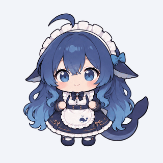

# AI Pet 1.21.0

让 AI 角色住在 Windows 桌面上：换皮肤、走动、和窗口互动，陪你聊天，也能在工作完成时提醒你。

AI Pet 将桌宠动画、**Ollama 本地聊天**、**Codex 任务看板**和**本地语音**放在一起。连接功能可以按需启用；不连接 Codex 或模型，也能使用桌宠与本地动画。

| 功能 | 已支持 |
| --- | --- |
| 角色与动画 | 9 款角色皮肤；DeepSeek 完整状态动画，新旧动画可切换 |
| 桌面互动 | 拖拽、行走、下落与落地、窗口支撑、跳跃和攀爬 |
| 对话与识图 | Ollama 地址配置、已安装模型切换、流式回答、图片拖入或粘贴 |
| 记录与记忆 | 本地会话历史、切换对话、跨对话共享记忆、可选联网搜索与网页阅读 |
| 语音 | 本地语音输入、DeepSeek 参考音色播报、流式播放、模型预加载与卸载 |
| 工作看板 | Codex 额度和任务、可选消息读取，Codex / Dot / 全部筛选 |

**当前仓库提供源码与资源，需要自行构建，不包含现成的 EXE / DLL、Python 环境或模型权重。**

## 角色预览

以下是可切换的**角色皮肤**，名称不代表程序内置了对应的 9 种大语言模型。聊天使用你自行配置的 Ollama 模型；目前只有 **DeepSeek** 配有完整状态动画。

<table>
  <tr>
    <td align="center"><br><strong>DeepSeek</strong></td>
    <td align="center"><br><strong>Gemini</strong></td>
    <td align="center"><br><strong>Claude</strong></td>
  </tr>
  <tr>
    <td align="center"><br><strong>GPT</strong></td>
    <td align="center"><br><strong>Grok</strong></td>
    <td align="center"><br><strong>GLM</strong></td>
  </tr>
  <tr>
    <td align="center"><br><strong>Kimi</strong></td>
    <td align="center"><br><strong>MiniMax</strong></td>
    <td align="center"><br><strong>Qwen</strong></td>
  </tr>
</table>

## DeepSeek 动画预览

精选六个**旧版动画**，以无声 GIF 循环展示，**不是 24 FPS 重绘版**。预览使用浅色背景，保留原动作与帧时长；GIF 的统一循环仅用于 README 展示，不改变软件中生气等一次性动作的播放规则。唱歌预览不含声音，软件中的音乐由独立开关控制。

<table>
  <tr>
    <td align="center"><br><strong>待机</strong></td>
    <td align="center"><br><strong>工作</strong></td>
    <td align="center"><br><strong>行走</strong></td>
  </tr>
  <tr>
    <td align="center"><br><strong>被拎起</strong></td>
    <td align="center"><br><strong>生气</strong></td>
    <td align="center"><br><strong>唱歌</strong></td>
  </tr>
</table>

软件内还有落地、开心、受惊、害羞、跳跃、攀爬及其它表演。可手动选择表情与表演；启用 LLM 行为模式后，也可让模型根据对话选择已安装动作。实际移动仍由桌面物理状态控制，拖拽、下落等被动状态不能由模型覆盖。

## 快速开始

### 环境要求

- **Windows 11 x64**、**.NET 10 SDK**。
- **Microsoft Edge WebView2 Runtime**：用于动画、视频和 Live2D。
- 可选的聊天与语音环境见下文；基本桌宠不需要先安装它们。

项目目标为 `net10.0-windows10.0.22000.0`。首次还原开发依赖需要联网；日常桌宠渲染和已安装的语音模型可离线运行。

### 构建与启动

在源码根目录打开 PowerShell：

```powershell
dotnet --version
.\desktop-pet\build.ps1 -Release
.\desktop-pet\launch.ps1
```

构建输出在 `desktop-pet/dist/`。保留完整输出目录及 `assets/`，不要只移动生成的 EXE。普通构建需要本机 .NET 10 Desktop Runtime。

<details>
<summary>直接使用 dotnet 构建，或自行发布包含运行时的程序目录</summary>

```powershell
dotnet restore .\desktop-pet\DesktopPet.csproj
dotnet build .\desktop-pet\DesktopPet.csproj -c Release --output .\desktop-pet\dist
.\desktop-pet\dist\DesktopPet.exe
```

如需自行发布包含 .NET 运行时的版本：

```powershell
dotnet publish .\desktop-pet\DesktopPet.csproj -c Release -r win-x64 --self-contained true --output .\artifacts\app
```

仓库没有附带这些命令的编译输出。WebView2、Python 和模型仍需另行准备。

</details>

### 基本操作

- **右键人物**：展开对话、设置、看板和更多图标。
- **双击人物**：打开人物旁的聊天面板。
- **设置**：换皮肤、调整大小与置顶、启停桌面行走和窗口互动。
- **场景动画**：预览动作、切换新旧版动画或导入自定义包。
- **系统托盘**：显示、隐藏或退出桌宠。

详细说明：[首次使用](首次使用.txt) · [场景动画](desktop-pet/动画说明.txt) · [Live2D](desktop-pet/Live2D说明.txt)

## 可选：Ollama 聊天

先启动 Ollama，并自行安装适合硬件的模型。在聊天连接设置中测试并保存服务根地址，默认是 `http://127.0.0.1:11434`；程序会自动读取该服务已安装的模型列表，供你选择和切换。

支持图片的模型可接收拖入、选取或粘贴的图片。模型支持范围与实际效果由所选模型决定，角色皮肤不会改变底层模型。当前连接设置不提供 API Key 或登录认证。

聊天面板支持流式回复、停止、新对话、历史会话和共享记忆。记录保存在本机，重新打开会话可以继续聊天；模型使用有限上下文，完整记录与每次发送的上下文并不等长。启用“联网”可搜索实时资料或读取公开网页链接，并显示来源。

“聊天模型”预加载与卸载按钮只控制当前选中的模型，不删除权重，也不修改 Ollama 全局设置。语音模型有独立控制，不会为了播报自动卸载聊天模型。

## 可选：本地声音与语音输入

| 功能 | 实现 | 运行资源 |
| --- | --- | --- |
| DeepSeek 语音播报 | faster-qwen3-tts + Qwen3-TTS-12Hz-1.7B-Base，使用参考人声 | Python 3.12、兼容的 NVIDIA GPU/驱动；加载检查至少 7 GiB 空闲显存 |
| 语音输入 | faster-whisper-small，多语言识别，CPU int8 | Python 3.12、CPU；不占用聊天模型显存 |

两项可单独安装。先准备 Python 3.12，再在源码根目录运行所需脚本：

```powershell
$python = (Get-Command python -ErrorAction Stop).Source

# 参考音色播报
.\desktop-pet\voice-service\setup-fast.ps1 -PythonExe $python -WorkspaceRoot (Get-Location).Path -DownloadModel

# 麦克风语音输入
.\desktop-pet\asr-service\setup.ps1 -PythonExe $python -WorkspaceRoot (Get-Location).Path -DownloadModel
```

安装脚本下载公开依赖与权重，环境保存在 `.tools/`。TTS 默认使用 `faster` 后端和 `desktop-pet/voice-service/reference.wav`；未提供参考音频时，需要自行放入有权使用的人声文件。详见 [便携语音说明](便携语音说明.txt)。

看板可开关播报、试听、停止、预加载与卸载语音。启用后，打开聊天会预热并保留语音模型，离开聊天后恢复空闲释放；手动卸载优先。流式播放会保留模型自然的句间停顿，首次加载和硬件负载仍会影响开口时间。

点击麦克风开始录音，再点一次结束；转写先进入输入框，检查后才发送。最长录音 60 秒，可取消。朗读与场景歌曲的声音开关独立，语音输入也可单独使用。

## 可选：Codex 工作看板

按 [首次连接说明](Codex首次连接.txt)，在自己的 Codex 本地任务中完成配对。连接要求同一电脑、同一 Windows 用户与会话中的官方 Codex App。

默认读取额度和任务列表，**消息正文需单独开启**。看板支持 Codex / Dot / 全部筛选；主桌宠的任务提醒目前只关注 Codex。账户额度不按任务来源拆分。

此功能使用 Codex App 内部接口，App 更新可能影响兼容性。身份或签名验证失败时程序不会连接；换电脑或 Windows 用户应重新配对。

## 项目结构与开发

```text
desktop-pet/
├─ DesktopPet.csproj    # WPF 桌面程序
├─ *.cs                # 界面、任务、聊天、动画、声音与本地数据
├─ assets/             # 角色、场景动画与浏览器运行资源
├─ live2d-web/          # Live2D Web 源码
├─ scene-web/           # 场景渲染相关测试与说明
├─ voice-service/       # 本地参考音色服务
├─ asr-service/         # 本地语音识别
├─ build.ps1
└─ launch.ps1
```

普通 C# 构建直接使用 `assets/` 中的浏览器运行资源，不要求 Node。修改 Live2D Web 源码时按 [前端构建说明](desktop-pet/live2d-web/README.md) 重建，保留 Cubism Framework/Core 的原版许可与独立文件。

配置模板使用相对路径，运行时从程序目录向上查找 `.tools/`，不依赖开发者机器目录。

## 数据与隐私

- 个人数据位于当前用户的 `%LOCALAPPDATA%\AIPet`；聊天正文、图片和配对材料使用 Windows 当前用户加密。仓库不包含个人数据。
- 默认 Ollama 请求发往本机；配置其它电脑时，消息与图片会发往该地址。开启联网搜索时，搜索词会发往搜索服务，网页正文交给所选模型。
- 语音录音只在主动操作时开始，本地识别不上传录音；确认发送后的文字遵循当前聊天与联网设置。
- 不要提交 `.tools/`、构建输出、缓存、日志、数据库、安装后的本机路径配置或连接记录。

## 许可与素材

项目本身**尚未声明统一开源许可证，授权范围待维护者明确**。第三方代码、运行库与模型分别遵守各自许可，请保留其 LICENSE、NOTICE、THIRD-PARTY 和作者信息。

人物、歌曲、参考人声及示例模型的权利独立于程序代码；软件或模型许可不自动授予这些素材的分发权利。Let Me Go 来源标注也不是录音分发授权，发布者应自行确认使用范围。
